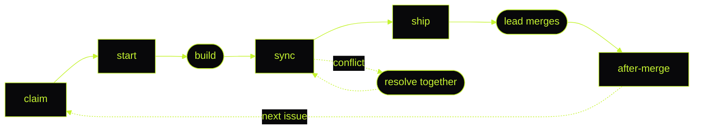

<p align="center">
  
</p>

Give this kit to your coding agent. It gets you set up for HackingDAO, then runs your daily flow so every merged task is credited to you.

| Skill | What it does |
| --- | --- |
| [hackingdao-setup](skills/hackingdao-setup/SKILL.md) | Checks your tools and GitHub account, clones your squad's entry repo, runs claim, start, sync, ship and after-merge. Comes with [build rules](skills/hackingdao-setup/rules.md) and a [brief template](skills/hackingdao-setup/brief-template.md). |
| [no-slop](skills/no-slop/SKILL.md) | Keeps everything you write plain: READMEs, pull requests, submissions. By 25TH, MIT. |
| [sessionclips](skills/sessionclips/SKILL.md) | Turns a build session into draft posts for X. By 25TH, MIT. |

## Install

All three skills use the open [Agent Skills](https://agentskills.io/specification) format: one folder per skill with a `SKILL.md` inside. Clone the kit once:

```sh
git clone https://github.com/DAOHacking/builder-kit.git
```

### Claude Code

Copy the skills into your personal skills folder:

```sh
mkdir -p ~/.claude/skills
cp -R builder-kit/skills/* ~/.claude/skills/
```

```powershell
New-Item -ItemType Directory -Force "$HOME\.claude\skills" | Out-Null
Copy-Item -Recurse builder-kit\skills\* "$HOME\.claude\skills\"
```

Then ask Claude Code to "set me up for HackingDAO", or type `/hackingdao-setup`. To keep them in one project only, copy them into that repo's `.claude/skills/` instead. ([Claude Code skills](https://code.claude.com/docs/en/skills))

### Codex, Cursor and Gemini CLI

All three read skills from `~/.agents/skills/`, so one copy serves them all:

```sh
mkdir -p ~/.agents/skills
cp -R builder-kit/skills/* ~/.agents/skills/
```

```powershell
New-Item -ItemType Directory -Force "$HOME\.agents\skills" | Out-Null
Copy-Item -Recurse builder-kit\skills\* "$HOME\.agents\skills\"
```

Sources: [Codex skills](https://learn.chatgpt.com/docs/build-skills), [Cursor skills](https://cursor.com/docs/context/skills), [Gemini CLI skills](https://geminicli.com/docs/cli/skills/). Gemini CLI can also install one skill straight from this repo:

```sh
gemini skills install https://github.com/DAOHacking/builder-kit.git --path skills/hackingdao-setup
```

### Any agent, through AGENTS.md

Entry repos made from the HackingDAO template carry these skills and an `AGENTS.md` that points to them. Codex, Cursor and Claude Code read `AGENTS.md` at the repo root on their own ([Codex](https://learn.chatgpt.com/docs/agent-configuration/agents-md), [Cursor](https://cursor.com/help/customization/rules), [Claude Code](https://code.claude.com/docs/en/memory)). Claude Code reads it when the repo has no `CLAUDE.md`. Gemini CLI reads it once `.gemini/settings.json` lists it ([configuration](https://geminicli.com/docs/reference/configuration/)):

```json
{ "context": { "fileName": ["AGENTS.md", "GEMINI.md"] } }
```

## The daily flow



## How points split

Each issue carries one size label from your squad lead: `size:S` is 1 point, `size:M` 3, `size:L` 8 and `size:XL` 13. Points go to whoever wrote the merged pull request that closes the issue. A prize splits the same way every time, locked before the squad starts:

$$
\text{prize} = \underbrace{75\%}_{\text{builders}} + \underbrace{10\%}_{\text{lead}} + \underbrace{10\%}_{\text{treasury}} + \underbrace{5\%}_{\text{scout}}
$$

$$
\text{your share} = 75\% \times \text{prize} \times \frac{\text{your points}}{\text{squad points}}
$$

## Steps

Ask your agent for any step by name.

<details>
<summary><strong>preflight</strong>: check git, node, npm and gh</summary>

Runs `git --version`, `node --version`, `npm --version` and `gh --version`. If one is missing you get its install link, and the agent waits until it is there.

</details>

<details>
<summary><strong>github</strong>: sign-in and two-factor authentication</summary>

Checks `gh auth status`. If you are not signed in, you run `gh auth login` yourself and finish in the browser. Then it checks two-factor authentication, or asks you to confirm it is on and shows where to turn it on: profile photo, **Settings**, **Password and authentication**.

</details>

<details>
<summary><strong>org</strong>: DAOHacking membership</summary>

Checks your membership. If an invite is waiting, you accept it at github.com/orgs/DAOHacking/invitation, and the agent checks again. It never accepts for you.

</details>

<details>
<summary><strong>entry</strong>: clone your squad's repo</summary>

Clones the entry repo you name, installs with `npm ci --ignore-scripts`, and copies `.env.example` to `.env`. It tells you which values to get from your squad lead. You type them in; the agent never sees them.

</details>

<details>
<summary><strong>claim</strong>: take an issue</summary>

Assigns the issue to you with `gh issue edit <number> --add-assignee @me`, and checks you are the only assignee. Your lead adds the size and guild labels.

</details>

<details>
<summary><strong>start</strong>: a branch from fresh main</summary>

Pulls `main` and creates `issue-<number>-<short-slug>`, for example `issue-12-add-wallet-connect-button`.

</details>

<details>
<summary><strong>sync</strong>: catch up with main</summary>

Fetches and rebases on `origin/main`. On a conflict it stops, explains both sides in plain words, and waits for you before resolving.

</details>

<details>
<summary><strong>ship</strong>: open the pull request</summary>

Runs the repo's lint, typecheck and test scripts if they exist, pushes, and opens a pull request from the repo's template with `Closes #<number>` in the body. That line is how your merged work is credited.

</details>

<details>
<summary><strong>after-merge</strong>: clean up</summary>

Once the pull request shows as merged: back to `main`, pull, delete the branch.

</details>

## Rules

The [build rules](skills/hackingdao-setup/rules.md) fit on one screen: install with `npm ci --ignore-scripts`, change only what the task needs, verify before saying it works, write plainly, no purple or gradients, no screen shake. The agent also never signs in or accepts invites for you, never handles secret values, never commits `.env` and never pushes to `main`.
